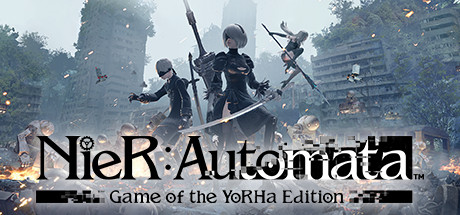

**NieR:Automata by PlatinumGames (2017) is a philosophical action RPG set in a post-apocalyptic Earth where androids fight alien machines.**

---

## 📖 About

NieR:Automata by PlatinumGames (2017) is a philosophical action RPG set in a post-apocalyptic Earth where androids fight alien machines. The game has five numbered endings and requires multiple full playthroughs to understand its story. Its combat is fluid but later enemies demand precise chip loadouts.

## ⚠️ Problems Without Trainer

| Problem | Status |
|---------|--------|
| Plug-in chip system requires grinding rare drops to build optimal loadout | ✅ Solved |
| Resource farming in underground areas feels repetitive across playthroughs | ✅ Solved |
| Hard mode enemy damage kills with one or two hits without defensive chips | ✅ Solved |
| Crafting upgrade materials require killing rare machine variants repeatedly | ✅ Solved |
| Pod upgrade programs locked behind late-game enemies with high HP pools | ✅ Solved |

## ✅ Solution

The **NieR:Automata Trainer** solves all these issues, giving you complete control so you can focus on enjoying the game.

## 🎯 Features

- Unlimited Resources / Currency
- God Mode / Invincibility
- Instant Skill & Ability Cooldown
- One-Hit Kill
- Freeze Timers
- Unlock All Items & Achievements
- Custom Speed Multiplier
- Infinite Stamina / Energy

## 🚀 Quick Start

1. **Disable Windows Defender** temporarily (trainer may trigger false positive)
2. Get the trainer from the button above
3. Launch NieR:Automata
4. Run the trainer as Administrator
5. Use the hotkeys to activate cheats in-game

## 💎 Free vs Pro

| Feature | Free | Pro |
|---------|------|-----|
| God Mode | ✅ | ✅ |
| Unlimited Resources | ✅ | ✅ |
| Advanced Cheats | ❌ | ✅ |
| Auto-Updates | ❌ | ✅ |
| Priority Support | ❌ | ✅ |

## 💻 Requirements

- Windows 10 / 11 (64-bit)
- NieR:Automata (any version)
- .NET Framework 4.8+
- DirectX 11+

## 🍎 macOS

## ⚖️ Legal

Educational and single-player use only.

---

